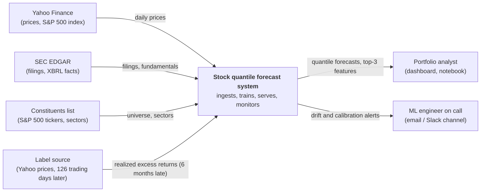
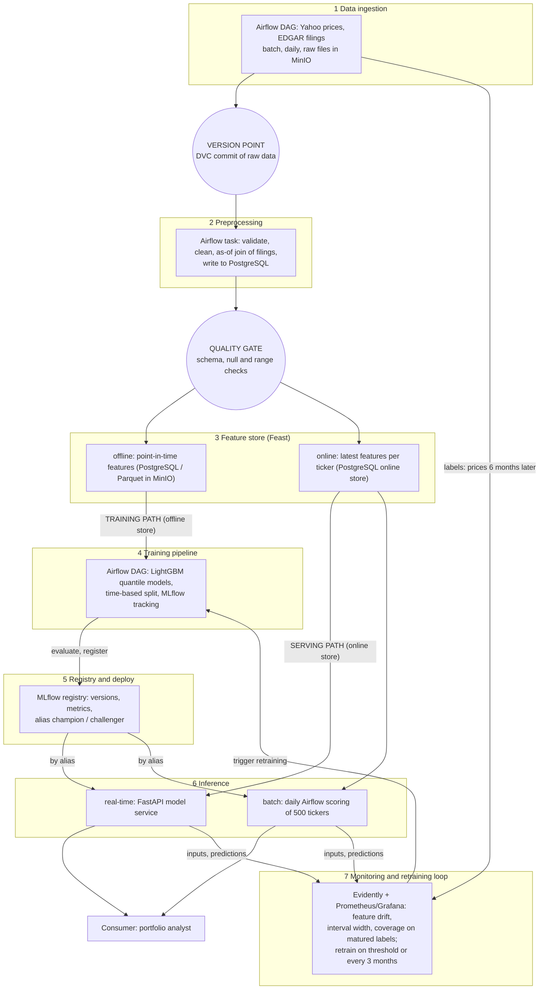
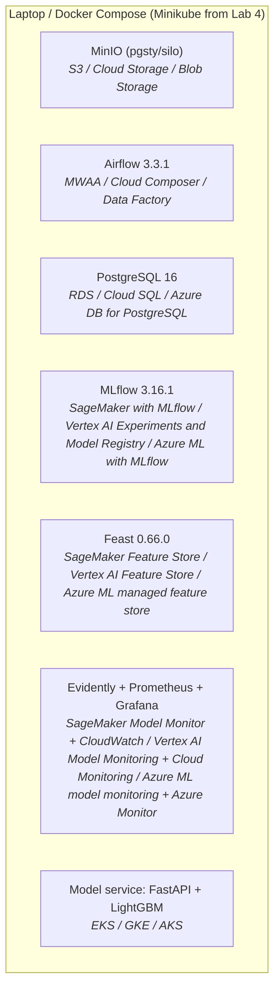

# Design document: 6-month stock excess-return quantile forecasting

Status: Lab 1 draft. Items marked **Assumption** are decisions made without full information; they are named so that later labs can confirm or revise them.

## 1 Overview

Investors with a holding period of months need an estimate of a stock's return and of its uncertainty, not a single up/down label. This system ingests daily prices and SEC filings for about 500 large US stocks and predicts five quantiles (10/25/50/75/90) of each stock's 6-month return relative to the S&P 500. Predictions are produced on a schedule, served through an API with the top feature contributions, and monitored for drift and calibration. The desired outcome is a reproducible, observable system whose forecasts are better calibrated than a simple momentum baseline.

## 2 Motivation

- **Who consumes the predictions:** a portfolio analyst (for the course, the author) who builds a watch-list from the forecast distributions. **Assumption:** a single human consumer, no automated trading.
- **How often:** the horizon is 6 months, so a daily refresh is sufficient. Features change slowly; filings arrive about four times a year per company.
- **Why not a notebook:** the inputs change daily and filings arrive irregularly, labels mature 6 months late, the model degrades as market regimes change, and the analyst needs the same answer tomorrow as the pipeline gave today, with a record of which data and model version produced it.
- **What happens when predictions are wrong:** the analyst takes a position that underperforms. The cost is financial and diffuse (a wrong forecast is not a crash), but a confidently wrong forecast, with a narrow interval that misses, is the worst case. This is why calibration is a first-class metric (section 3).

## 3 Success metrics

| Layer | Metric | Target |
| --- | --- | --- |
| Business / decision | Realized 6-month excess return of the top-decile stocks ranked by predicted median, versus the universe average, on matured predictions | > 0 over rolling 12 months. **Assumption:** noisy and may well not hold; reported honestly, not optimized. |
| Model (optimization) | Mean pinball loss across the five quantiles on the time-based holdout | Lower than the baseline's pinball loss on the same holdout |
| Model (satisficing) | Empirical coverage of each quantile (share of realized returns below the q-th prediction) | Within ±5 percentage points of q on the holdout and on matured live predictions |
| System | Freshness: predictions for every ticker computed from data at most 1 trading day old | 99% of trading days |
| System | p95 latency of the online prediction endpoint | < 500 ms p95 including top-3 feature contributions. **Assumption.** |
| System | Availability of the prediction API | 99% monthly. **Assumption:** single analyst consumer, local deployment. |

The optimization metric is pinball loss (the one to minimize); coverage, latency and freshness are satisficing metrics (thresholds to meet).

## 4 Requirements and constraints

### Functional

- **Inputs:** a ticker (or the list of all tickers) and an as-of date, defaulting to the latest.
- **Outputs:** five quantiles of the 6-month excess return, the derived P(outperform), the model version, the data version, and the top-3 SHAP feature contributions.
- **Who calls:** the analyst's dashboard or notebook over HTTP (online), and the daily batch job that writes predictions for the full universe to PostgreSQL (batch).
- **What is returned:** JSON for online requests; a table of predictions with timestamps for batch.

### Non-functional (one row per category)

| Category | Requirement |
| --- | --- |
| Freshness | Price data at most 1 trading day old at scoring time; fundamentals as of the latest filing, which can be up to about 3 months old (stated in the response). |
| Latency and throughput | Online p95 < 500 ms; about 1 request/s peak (**Assumption**, one consumer). Batch scoring of 500 tickers in < 10 minutes. |
| Availability and fallback | 99% monthly. If the model or the online store is unavailable, the API returns the baseline (12-month momentum quantiles), flagged `fallback: true`. |
| Reproducibility | Every prediction is traceable to a git commit, a DVC data version and an MLflow model version. A clean clone reproduces the environment with `make setup`. |
| Adaptability (new data and new models) | New daily prices and filings are ingested incrementally; a retrain is triggered by coverage or drift thresholds (section 5.5) and at least once every 3 months. A new model is promoted only after beating the champion on the same holdout. |
| Observability without ground truth | Labels arrive 6 months late, so for 6 months only label-free signals are available: feature drift, prediction-distribution drift, interval width, share of quantile crossings, pipeline freshness. Coverage is computed only on matured predictions. |
| Cost and resource ceilings | Local: 4 GB Minikube, a laptop CPU, no GPU needed for LightGBM. Cloud estimate in section 6.7 under about 300 USD per month (**Assumption**). |

### In scope

- Quantile forecasts of 6-month excess return for a universe of about 500 current S&P 500 constituents.
- Scheduled ingestion, data versioning, training, tracking, registry, batch and online serving, monitoring.
- In later labs: an LLM component over company filings (Lab 3) and an agent (Lab 5).

### Out of scope

- 1–5 year horizons (labels arrive too late to monitor or to hold out; see 7.1).
- Trading execution, portfolio optimization, transaction costs, position sizing.
- Intraday data and streaming ingestion.
- Non-US stocks, other asset classes.

## 5 Data and ML

### 5.1 Problem statement

**Framing:** probabilistic forecasting by quantile regression. For each stock and as-of date *t*, predict the quantiles q ∈ {0.10, 0.25, 0.50, 0.75, 0.90} of the excess return over the next 126 trading days, where excess return = stock total return − S&P 500 total return over the same window. P(outperform) is derived by interpolating the predicted quantiles at 0.

**Rejected framing:** binary classification (outperform / underperform). It discards the size of the move and gives no uncertainty, so the analyst cannot tell a confident +1% from a wild +1% expectation; its single probability also cannot be checked for calibration of the spread. Another rejected framing, absolute price forecasting, is dominated by market-wide moves and is non-stationary.

### 5.2 Data

- **Sources:**
  - Daily OHLCV, adjusted close and the S&P 500 index (`^GSPC`) from Yahoo Finance (chart API, via `yfinance`). Reachability checked on 2026-10-18; history for AAPL starts in 1980. Fallback source: Stooq. **Risk:** Yahoo's API is unofficial and can change without notice.
  - Company filings (10-K, 10-Q) and XBRL fundamentals from SEC EDGAR (`data.sec.gov`), free and official; requires a descriptive User-Agent.
  - Universe: current S&P 500 constituents list. **Assumption:** using today's constituents introduces survivorship bias (see 6.9).
- **Arrival pattern:** prices daily after market close; filings irregular (about 4 per company per year). Batches are by date, so Lab 2 can ingest "the next month" and Lab 4 can inject drift.
- **Labels and their delay:** the label for a prediction made on date *t* is the realized excess return up to *t* + 126 trading days. It becomes available **6 months after the prediction**. The most recent 6 months of predictions are unlabeled by definition.
- **Training time versus serving time:** at training time, the full price history up to the label's maturity is available, and fundamentals as they were published (by filing date). At serving time, only data up to the as-of date exists, and the label does not.
- **Checklist justification (step 1):**
  - *Time axis:* yes, daily timestamps for prices, and filing dates for fundamentals.
  - *Enough history to hold out a period:* prices from about 2000 onwards (about 26 years, **Assumption** of the cut-off); the holdout is the most recent period with matured labels (see 5.4).
  - *Labels with a known arrival delay:* 6 months, stated above; it drives the monitoring design.
  - *Text surface or documented corpus:* the 10-K and 10-Q filings of the same companies on EDGAR (risk factors and MD&A sections) are the corpus for Lab 3.

### 5.3 Techniques

- **Baseline:** a rule, 12-month momentum. The five quantiles are the empirical quantiles of the historical excess returns of stocks in the same momentum bucket, computed on the training period only. A trivial second baseline: the unconditional quantiles of the training period (always predict the same distribution). **Would the baseline qualify as a production model?** Possibly: if the candidate does not beat it on pinball loss on the holdout, the baseline stays in production. This is checked by comparing both on the same holdout and on matured live predictions.
- **Candidate:** gradient-boosted trees (LightGBM), one model per quantile with the quantile objective.
- **Second candidate (challenger, after Lab 2):** a quantile neural network that outputs all five quantiles at once, trained on the sum of the five pinball losses. Literature suggests it can beat tree models on stock return quantiles (to be verified against the paper's setup). Trade-offs: more sensitive to feature scaling and random seeds, and slower, approximate explanations (no exact TreeSHAP), which affects the latency budget in 6.3. It enters only through the comparison rule in 5.4: it is promoted only if it beats LightGBM on pinball loss with coverage within ±5 points.
- **Features** (and the source of their value at serving time):

| Feature | Serving-time source |
| --- | --- |
| Return over 1, 3, 6, 12 months | Yahoo adjusted close, up to the as-of date (online store, refreshed daily) |
| 60-day realized volatility; 12-month max drawdown | Yahoo adjusted close, computed by the pipeline |
| Return relative to the S&P 500 over 3, 12 months | Yahoo stock and `^GSPC` prices |
| Dollar volume (20-day average) | Yahoo volume × price |
| Price / earnings (trailing), price / book | Latest EDGAR XBRL filing available on the as-of date × current price |
| Revenue growth (year over year), net margin | Latest EDGAR XBRL filing available on the as-of date |
| Sector (categorical) | Static reference table from the constituents list |

**Training-serving skew (named):** the EDGAR "company facts" API returns values that include later restatements. Training on those would use numbers the market did not have at the time. The pipeline therefore keeps the value as first filed, with its filing date, and the as-of join uses only filings with a filing date ≤ the as-of date. Price-based features are computed the same way offline and online, from the same code.

### 5.4 Experimentation and validation

- **Split:** by time, never random. Random splitting leaks future market regimes into training and, because 6-month windows of neighboring dates overlap, leaks labels. **Assumption (dates to confirm in Lab 2):** train on as-of dates up to 2021-12-31; validation 2022-01-01 to 2023-06-30; final test 2023-07-01 to 2026-04-18, the latest date whose label has matured (today is 2026-10-18).
- **Purge:** training rows whose 126-day label window overlaps the start of the validation or test period are dropped (a gap of 6 months at each boundary).
- **Offline metric:** mean pinball loss over the five quantiles, plus per-quantile coverage and the mean interval width. Reported per calendar year to expose regime dependence.
- **Comparing a new model with the current one:** both are evaluated on the same fixed holdout and on the matured live predictions; the new one must have lower pinball loss **and** coverage within ±5 points of nominal. Results are logged in MLflow. **Assumption:** a second criterion, no worse than the champion in the most recent year, to catch a model that only wins on old data.

### 5.5 Human in the loop

- **Drift alert:** the author (acting as the on-call ML engineer) reviews the Evidently report and the alert, decides whether the drift is a data problem (broken source, schema change) or a real regime change, and triggers or skips a retrain.
- **Model promotion:** a candidate that passes the automatic comparison (5.4) is registered in MLflow with the alias `challenger`. The author reviews the global SHAP importance against the champion's and the coverage table, and moves the alias `champion` by hand. Nothing is promoted automatically.
- **Override:** the author can pin the alias `champion` to an older version, or force `fallback: true` (baseline) for all requests, with one command. An override is recorded in MLflow with a reason. **Assumption:** a single reviewer, so no second approval.

## 6 Architecture and operations

### 6.1 High-level design

All three diagrams use the component names from section 6.2.

#### System context

#### Data flow (seven layers)

Marks on the diagram: the **version point** is after ingestion (a DVC commit of the raw data in MinIO); the **quality gate** is after preprocessing and before the feature store (a failing batch stops the run); the **training path** reads the offline side of Feast and the **serving path** reads the online side, which is where training-serving skew can enter. No layer is skipped: streaming is not used (daily batch ingestion is enough), but all seven layers exist.

#### Deployment, first draft

First draft: replaced by the real cluster topology in Lab 4. DVC (3.67.1, remote on MinIO) runs as a command-line tool, not as a service. The Lab 3 components (pgvector, vLLM) will be added then.

### 6.2 Infra

Local stack (pinned versions from the course reference table) and the managed service I would use instead:

| Component | Local reference | AWS | GCP | Azure |
| --- | --- | --- | --- | --- |
| Object storage, data lake | MinIO-compatible `pgsty/silo:RELEASE.2026-09-16T00-00-00Z` | Amazon S3 | Cloud Storage | Blob Storage |
| Data versioning remote | DVC 3.67.1 + dvc-s3 3.3.0, remote on MinIO | S3 remote | GCS remote | Azure Blob remote |
| Warehouse, serving database | PostgreSQL 16 | Amazon RDS | Cloud SQL | Azure Database for PostgreSQL |
| Orchestrator | Apache Airflow 3.3.1, LocalExecutor | Amazon MWAA | Cloud Composer | Azure Data Factory |
| Experiment tracking and model registry | MLflow 3.16.1, PostgreSQL backend, MinIO artifacts | SageMaker with MLflow | Vertex AI Experiments and Model Registry | Azure ML with MLflow |
| Feature store | Feast 0.66.0 | SageMaker Feature Store | Vertex AI Feature Store | Azure ML managed feature store |
| Kubernetes cluster (Lab 4) | Minikube 1.33.1 (Kubernetes 1.30.0, docker driver, 4 GB) | Amazon EKS | GKE | AKS |
| Model and data monitoring | Evidently | SageMaker Model Monitor | Vertex AI Model Monitoring | Azure ML model monitoring |
| Metrics store and dashboards | Prometheus, Grafana | Amazon CloudWatch | Cloud Monitoring | Azure Monitor |
| Container registry (Lab 4) | Minikube built-in registry | Amazon ECR | Artifact Registry | Azure Container Registry |
| Vector store (Lab 3) | pgvector 0.8.7 | OpenSearch Serverless vector search | Vertex AI Vector Search | Azure AI Search |
| LLM inference (Lab 3) | vLLM 0.30.0 or an API | Amazon Bedrock | Vertex AI generative AI | Azure OpenAI |

The model service itself (FastAPI + LightGBM) is a container; its managed equivalent is the Kubernetes cluster row (EKS / GKE / AKS). Spark and Kafka are **not needed**: the data is daily, small (500 tickers × ~6,500 days ≈ 3 million price rows), and fits in PostgreSQL and a laptop's memory.

**Managed-versus-local trade-off, one example:** running Airflow as Amazon MWAA instead of local Airflow would gain managed upgrades, scaling and high availability, and lose cost (MWAA has a fixed hourly environment fee even when idle) and the ability to debug the scheduler directly.

### 6.3 Performance

- **Online budget:** p95 < 500 ms per request, of which: feature lookup from the online store ≤ 50 ms, five quantile model predictions ≤ 20 ms, SHAP top-3 ≤ 200 ms (**Assumption**, to be measured in Lab 4; SHAP is the most expensive step), serialization and overhead the rest. Throughput: about 1 request/s (single consumer).
- **Batch budget:** scoring of 500 tickers in < 10 minutes, once per trading day.
- **Batch versus online:** **batch is the primary mode.** The horizon is 6 months, features change daily, and the consumer builds a watch-list rather than making split-second decisions, so a full-universe daily score written to PostgreSQL is enough and cheaper. The online endpoint exists for ad-hoc lookups of one ticker, including its explanation, and as the target of the Lab 4 serving work.

### 6.4 Security

- **Secrets:** none are committed. Local credentials (MinIO, PostgreSQL, Airflow) live in a git-ignored `.env` file; on Minikube (Lab 4) they become Kubernetes Secrets. The SEC User-Agent contact string is configuration, not a secret.
- **Access:** the API is reachable only from localhost / the cluster; an API key header is required for the prediction endpoint (**Assumption**, introduced in Lab 4). Only the author has access to MLflow and Airflow UIs, behind local credentials.

### 6.5 Data privacy

- **Personal data:** none about individuals. The dataset contains public market prices and public company filings. Filings name executives; they are not extracted as features and are not stored separately from the filings.
- **Retention:** raw data is kept for the project's lifetime (it is versioned in DVC and needed for reproducibility); no user-level data (requests are logged by ticker and timestamp only).
- **Terms of use:** Yahoo Finance data is for personal / educational use only (**Assumption**: not redistributed; the repository contains no raw data).

### 6.6 Monitoring and alarms

First draft; Lab 4 makes it real.

| What is logged / computed | Threshold (all **Assumptions**) | Who is alerted |
| --- | --- | --- |
| Pipeline freshness: latest price date in PostgreSQL | Alert if older than 2 trading days (catches a job that "succeeds" but re-reads the same partition) | ML engineer (the author) via email/Slack |
| Row counts per ingestion run and per ticker | Alert if a run's row count is 0 or below 80% of the previous run's | ML engineer |
| Quality gate failures (schema, nulls, ranges) | Any failure stops the run and alerts | ML engineer |
| Feature drift (Evidently, population stability / KS test) on each feature versus the training reference | Alert if more than 30% of features drift for 5 consecutive days | ML engineer |
| Prediction distribution and interval width (10–90 spread) | Alert if the median spread moves by more than 50% versus the last 90 days | ML engineer |
| Quantile crossing rate in raw model outputs | Alert above 5% of predictions | ML engineer |
| Quantile coverage on matured labels | Alert if any quantile's coverage deviates by more than 5 percentage points from nominal over the last 3 months of matured predictions | ML engineer, triggers the retraining review (5.5) |
| Latency p95, error rate, fallback rate (online) | p95 > 500 ms, errors > 1%, fallback > 0 | ML engineer |

Because labels arrive after 6 months, coverage cannot be checked for new predictions for 6 months; the label-free rows above are the only early warning in that window.

### 6.7 Cost

Estimated monthly cost of the managed (AWS) column, even though everything runs locally. **Assumption: rough numbers, to be replaced by calculator output (https://calculator.aws/) in a later lab; they have not yet been verified.**

| Component | Managed service and size assumed | Estimate (USD / month) |
| --- | --- | --- |
| Object storage | S3, about 20 GB | ~1 |
| Database | RDS PostgreSQL, small instance, 50 GB | ~30–60 |
| Orchestrator | MWAA small environment | ~300 (the largest item; a self-hosted Airflow on the cluster would be cheaper) |
| Kubernetes | EKS control plane + 2 small nodes | ~130 |
| Tracking / registry, feature store, monitoring | self-hosted on the same cluster, plus CloudWatch | ~20 |
| **Total** | | **~500** |

This exceeds the 300 USD ceiling in section 4. The first thing I would relax is the orchestrator choice (replace MWAA with Airflow on the cluster, about −300), not any model requirement. Data costs are nil: Yahoo and EDGAR are free.

### 6.8 Integration points

| Party | Role | Contract |
| --- | --- | --- |
| Yahoo Finance | Upstream owner of prices | Unofficial API, no SLA. Contract: daily OHLCV + adjusted close per ticker; the pipeline's quality gate rejects a batch with missing columns or non-positive prices. Fallback source: Stooq. |
| SEC EDGAR | Upstream owner of filings and XBRL facts | Official API, fair-use rate limit (about 10 requests/s) and a User-Agent with contact details. Schema is stable per XBRL tag; changes are caught by the quality gate. |
| Constituents list | Upstream universe and sector table | Static CSV in the repository, refreshed manually each quarter. |
| Portfolio analyst | Downstream consumer | HTTP `POST /predict` and a `predictions` table in PostgreSQL. Response schema: ticker, as-of date, five quantiles, p_outperform, top-3 features, model version, data version, `fallback` flag. Changes to the schema are versioned (`/v1/`). |
| ML engineer (author) | Alert recipient | Email or Slack message with the alert name, the metric, its value and a link to the dashboard. |

### 6.9 Risks and uncertainties

| Risk | Mitigation |
| --- | --- |
| Survivorship bias: using today's S&P 500 constituents leaves out companies that were delisted or dropped | Documented as a known bias; the evaluation reports per-year results; if a point-in-time constituents list is found, it replaces the static one |
| Returns are close to unpredictable; the candidate may not beat the baseline | The baseline is a valid production model by design (5.3); the project is graded on the system, not on alpha |
| Yahoo's unofficial API changes or blocks requests | Raw data is versioned so past runs stay reproducible; Stooq as a fallback; the quality gate catches schema breaks |
| Training-serving skew from restated fundamentals | Store values as first filed, join by filing date (5.3) |
| Label delay of 6 months hides model degradation | Label-free monitoring (6.6); scheduled retrain every 3 months regardless |
| Overlapping 6-month label windows leak information between train and test | Purged boundaries (5.4) |
| Market regime change (for example 2022) invalidates the learned relationships | Per-year reporting and the "no worse in the most recent year" promotion rule |
| Cost of managed services exceeds the ceiling | Replace MWAA with self-hosted Airflow (6.7) |

## 7 Other

### 7.1 Alternatives

| Alternative rejected | Pros | Cons | Reason |
| --- | --- | --- | --- |
| **1–5 year horizon model** (the original idea) | Closer to "long-term investing"; fundamentals matter more at long horizons | Labels arrive 1–5 years late, so there is nothing to monitor or retrain on within the course; a 5-year label needs 15 or more years of history to hold out a single period; far fewer independent samples | Label delay makes the system unobservable; the 6-month horizon gives 30+ non-overlapping holdout windows |
| **Binary classifier** (outperform / not) | Simple; easy to explain; one model | No magnitude, no uncertainty, calibration of spread cannot be checked | Quantile regression gives a distribution and a derived probability |
| **Full parametric distribution** (for example a normal or Student-t head from a neural network) | A full density | Assumes a distribution shape; returns are fat-tailed and skewed; heavier tooling | Five quantiles are distribution-free and cheap to monitor via coverage |
| **Kafka + Spark streaming** | Real-time ingestion | Adds complexity and cost with no benefit at daily frequency | Daily batch is enough (section 6.3) |
| **Paid data vendor** (for example Bloomberg, Refinitiv) | Point-in-time, survivorship-free data | Cost, licence, not reproducible by a reviewer | Free sources keep the repository reproducible |

### 7.2 Experiment results

Placeholder; Lab 2 fills this in (baseline and candidate pinball loss, coverage per quantile, MLflow run links).

### 7.3 Monitoring results

Placeholder; Lab 4 fills this in (dashboard screenshots, an injected drift and the alert received).

### 7.4 Milestones

- **Lab 2:** DVC-versioned raw data on MinIO, an idempotent Airflow ingestion with a quality gate, the baseline and LightGBM quantile models tracked in MLflow, and a registered model with lineage (data version and commit).
- **Lab 3:** an LLM component that retrieves from the 10-K / 10-Q corpus (pgvector, vLLM or an API), with an evaluation set, versioned prompts and cost / latency recorded, to answer questions about the forecasted company.
- **Lab 4:** containerized services on Minikube with health probes, scheduled Evidently reports and a Grafana dashboard, an injected drift reaching the on-call engineer, and one command to bring everything up.
- **Lab 5:** an agent that calls the forecast service and the filing retriever as tools, with persisted traces and a ten-task evaluation run twice.
